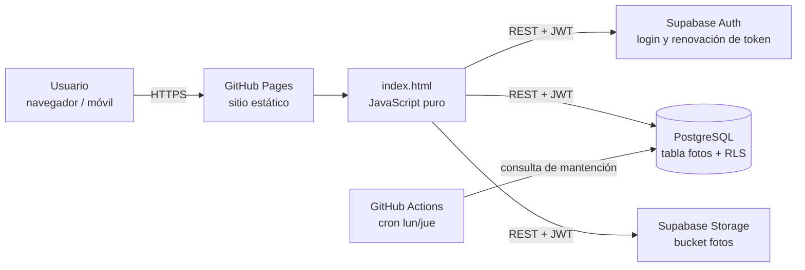

<div align="center">

# Nuestra Historia

**Aplicación web interactiva con galería de fotos en la nube, autenticación y base de datos PostgreSQL. No usa frameworks: está hecha con JavaScript puro.**

[](https://arrobaaas.github.io/nuestra-historia/)


[**Ver demo en vivo →**](https://arrobaaas.github.io/nuestra-historia/)

</div>

---

## Tabla de contenidos

- [Descripción](#descripción)
- [Funcionalidades](#funcionalidades)
- [Arquitectura](#arquitectura)
- [Aspectos técnicos destacados](#aspectos-técnicos-destacados)
- [Seguridad](#seguridad)
- [Stack tecnológico](#stack-tecnológico)
- [Estructura del proyecto](#estructura-del-proyecto)
- [Instalación y ejecución local](#instalación-y-ejecución-local)
- [Despliegue](#despliegue)
- [Próximas mejoras](#próximas-mejoras)
- [Autor](#autor)

---

## Descripción

**Nuestra Historia** es una *single-page application* que reúne una carta interactiva, un catálogo de 100 mensajes con buscador y filtros, un generador de ideas de salidas y una **galería de fotos compartida en la nube**. Dos usuarios autenticados pueden subir y administrar las fotos, y cualquier visitante puede verlas.

Empezó como un proyecto personal y lo construí con las mismas prácticas que un producto real: un backend gestionado con **Supabase** (PostgreSQL, Auth y Storage), **políticas de seguridad a nivel de fila (RLS)**, el manejo de sesiones con JWT y su renovación automática hechos desde cero, optimización de imágenes en el cliente y una interfaz *mobile-first* accesible.

No usa ningún framework ni el SDK de Supabase: toda la comunicación con el backend son llamadas `fetch` directas a la API REST. Así el sitio es liviano y se ve cómo funciona cada pieza por dentro.

---

## Funcionalidades

| Módulo | Descripción |
|---|---|
| **Carta interactiva** | Sobre animado en 3D (CSS `perspective` y `rotateX`) que se abre, se cierra y se sella con un sello de cera. |
| **100 razones** | Catálogo de 100 tarjetas con búsqueda de texto en tiempo real, filtros por categoría, revelado progresivo y selección aleatoria. |
| **Galería en la nube** | Subida, visualización, ampliación (*lightbox*) y borrado de fotos. Las fotos se ordenan por la fecha que se elige con un selector de calendario. |
| **Ideas de salidas** | Tarjetas por categoría, generador aleatorio y seguimiento de las ideas completadas. |
| **Contador en vivo** | Tiempo transcurrido desde una fecha clave, que se actualiza cada segundo. |
| **Reproductor de música** | Widget flotante que se puede arrastrar (Pointer Events) y que recuerda su posición entre visitas. |
| **Efectos visuales** | Partículas animadas en `<canvas>` con `requestAnimationFrame` y confeti. |

---

## Arquitectura



- **Frontend estático** servido por GitHub Pages, sin paso de compilación al desplegar.
- **Backend como servicio (BaaS):** Supabase entrega la autenticación, la base de datos PostgreSQL expuesta mediante PostgREST y el almacenamiento de archivos.
- **Automatización:** un workflow de GitHub Actions programado evita que el proyecto de Supabase, en el plan gratuito, se pause por inactividad.

---

## Aspectos técnicos destacados

### Autenticación sin SDK
Implementé el flujo de autenticación directamente contra los endpoints de Supabase Auth (`/auth/v1/token`):
- Login con `grant_type=password` y la sesión guardada en `localStorage`.
- **Renovación automática del token:** antes de cada petición se revisa la expiración del JWT y, si quedan menos de 60 segundos, se pide uno nuevo con el `refresh_token`.
- Un *wrapper* centralizado (`sbFetch`) agrega las cabeceras `apikey` y `Authorization` y maneja los errores de forma uniforme.

### Optimización de imágenes en el cliente
Antes de subir una foto, el navegador la procesa:
- La redimensiona a un máximo de **1600 px** con `<canvas>` y la recomprime como JPEG (calidad 0.85). Esto reduce el tamaño unas **10 veces** sin una pérdida visible de calidad.
- Respeta la orientación EXIF con `createImageBitmap(..., { imageOrientation: 'from-image' })` y, si el navegador no lo soporta, usa `Image` como alternativa.
- **Subida transaccional:** si la imagen se sube al Storage pero falla el registro en la base de datos, se borra el archivo para no dejar archivos huérfanos.

### Ordenamiento por fecha con compatibilidad hacia atrás
Las fotos nuevas guardan la fecha en formato ISO (`YYYY-MM-DD`). Las antiguas tenían la fecha en texto libre ("16 de agosto de 2026"), así que un *parser* las interpreta para ordenar toda la galería de forma consistente sin migrar los datos.

### Rendimiento y experiencia de usuario
- Imágenes con `loading="lazy"` y `decoding="async"`, y caché de un año en los archivos subidos.
- Respeta `prefers-reduced-motion` y desactiva las animaciones cuando el usuario lo pide.
- Diseño *mobile-first*: entradas de 16 px para evitar el zoom automático en iOS, soporte de `viewport-fit=cover` y zonas táctiles adecuadas.
- La interacción de la galería usa delegación de eventos en lugar de un *listener* por tarjeta.

---

## Seguridad

| Medida | Implementación |
|---|---|
| **Row Level Security** | Activado en la tabla `fotos`. La lectura es pública y solo los usuarios autenticados pueden insertar. |
| **Borrado restringido al dueño** | Política `auth.uid() = subida_por`: cada usuario solo puede borrar lo que subió. Lo mismo aplica en Storage (`owner = auth.uid()`). |
| **Validación en Storage** | Bucket limitado a 5 MB por archivo y a los tipos MIME `image/jpeg`, `image/png` e `image/webp`. |
| **Gestión de claves** | En el frontend solo está la clave pública (*publishable/anon*). La clave `service_role` nunca sale del panel de Supabase. |
| **Prevención de XSS** | Todo el contenido que escriben los usuarios se escapa con `escapeHtml` antes de insertarlo en el DOM. |

Todo el esquema y las políticas están versionados en [`supabase_setup.sql`](supabase_setup.sql). El script es **idempotente** y se puede ejecutar varias veces sin efectos secundarios.

---

## Stack tecnológico

| Capa | Tecnología |
|---|---|
| Frontend | HTML5 semántico, JavaScript (ES2020+), Tailwind CSS, Canvas API, Pointer Events |
| Íconos y tipografía | Lucide Icons, Google Fonts |
| Backend | Supabase: PostgreSQL, PostgREST, Auth (JWT), Storage |
| Seguridad | Row Level Security, políticas de Storage, escape de HTML |
| Automatización | GitHub Actions (workflow programado con cron) |
| Hosting | GitHub Pages |

---

## Estructura del proyecto

```
nuestra-historia/
├── index.html                      # Aplicación completa (marcado, estilos y lógica)
├── tailwind.css                    # Hoja de estilos de Tailwind ya compilada
├── config.js                       # URL y clave pública de Supabase
├── supabase_setup.sql              # Esquema, políticas RLS y bucket de Storage (idempotente)
├── cancion.mp3                     # Audio del reproductor
├── .nojekyll                       # Desactiva el procesamiento de Jekyll en GitHub Pages
└── .github/
    └── workflows/
        └── mantener-activo.yml     # Cron que mantiene activa la base de datos
```

---

## Instalación y ejecución local

**Requisitos:** un navegador moderno y, si quieres usar la galería en la nube, una cuenta gratuita en [Supabase](https://supabase.com).

```bash
# 1. Clonar el repositorio
git clone https://github.com/arrobaaas/nuestra-historia.git
cd nuestra-historia

# 2. Levantar un servidor local (cualquiera sirve)
python3 -m http.server 8000
# Abrir http://localhost:8000
```

**Configurar el backend (opcional):**

1. Crea un proyecto en Supabase.
2. En **SQL Editor**, ejecuta el contenido de `supabase_setup.sql`.
3. En **Authentication → Users**, crea los usuarios que podrán subir fotos.
4. Copia la *Project URL* y la clave *publishable/anon* en `config.js`:

```js
window.CATALINA_CONFIG = {
  supabaseUrl: "https://<tu-proyecto>.supabase.co",
  supabaseAnonKey: "<tu-clave-publica>"
};
```

> Si `config.js` no tiene credenciales, el sitio funciona igual y solo desactiva la galería en la nube.

---

## Despliegue

El sitio se despliega automáticamente en **GitHub Pages** con cada *push* a la rama `main`.

El workflow [`mantener-activo.yml`](.github/workflows/mantener-activo.yml) se ejecuta los lunes y jueves y hace una consulta liviana a la API, porque Supabase pausa los proyectos gratuitos después de 7 días sin actividad. También se puede ejecutar a mano desde la pestaña **Actions**.

---

## Próximas mejoras

- [ ] Editar el título, la fecha y la descripción de las fotos ya subidas.
- [ ] Separar `index.html` en módulos ES (`/js`, `/css`) con un *bundler* liviano como Vite.
- [ ] Convertirla en una PWA con soporte *offline* y opción de instalarla en el celular.
- [ ] Agregar pruebas automatizadas (Playwright) a la integración continua.

---

## Autor

**Nicolás**, desarrollador web

[](https://github.com/arrobaaas)

<sub>Proyecto personal hecho con dedicación para Catalina ♡</sub>
