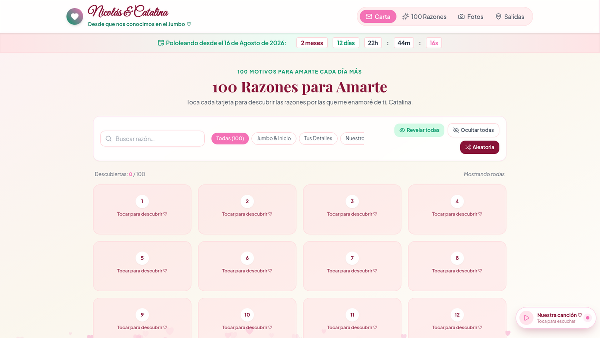
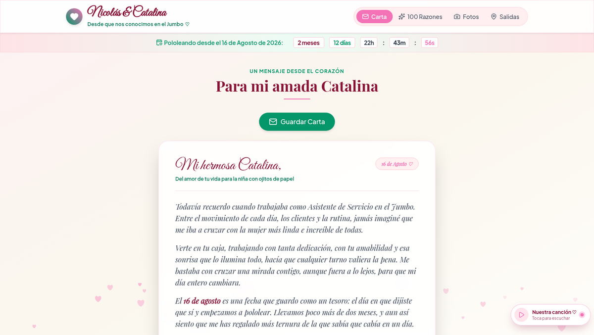
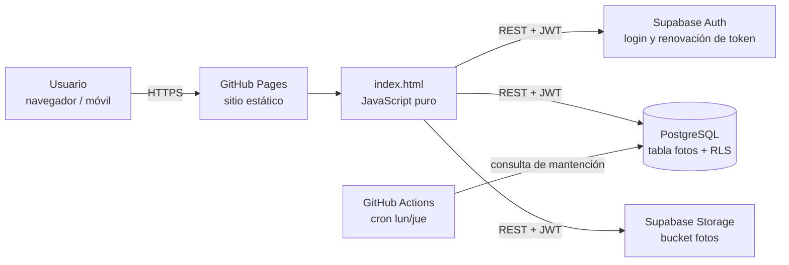

<div align="center">

# Nuestra Historia

**SPA en JavaScript puro con galería de fotos en la nube, autenticación JWT implementada sin SDK y backend Supabase (PostgreSQL + Storage) protegido con Row Level Security.**

[](https://arrobaaas.github.io/nuestra-historia/)
[](LICENSE)




</div>

> **In English:** A framework-free single-page app with a cloud photo gallery. Authentication talks directly to the Supabase Auth REST API (no SDK) with automatic JWT refresh; data lives in PostgreSQL protected by Row Level Security, and images are resized and re-compressed in the browser before upload. Deployed on GitHub Pages with a scheduled GitHub Actions workflow.

---

## Tabla de contenidos

- [Resumen](#resumen)
- [Capturas](#capturas)
- [Funcionalidades](#funcionalidades)
- [Arquitectura](#arquitectura)
- [Aspectos técnicos destacados](#aspectos-técnicos-destacados)
- [Decisiones técnicas](#decisiones-técnicas)
- [Seguridad](#seguridad)
- [Stack tecnológico](#stack-tecnológico)
- [Estructura del proyecto](#estructura-del-proyecto)
- [Ejecutar en local](#ejecutar-en-local)
- [Despliegue](#despliegue)
- [Limitaciones conocidas y próximas mejoras](#limitaciones-conocidas-y-próximas-mejoras)
- [Autor](#autor)

---

## Resumen

Aplicación de una sola página (SPA) con cuatro módulos: una carta interactiva, un catálogo de 100 tarjetas con buscador y filtros, un generador de ideas de salidas y una **galería de fotos compartida en la nube**. Los usuarios autenticados suben y administran fotos; cualquier visitante puede verlas.

Lo que el proyecto demuestra:

- **Integración con un backend real sin librerías cliente:** toda la comunicación con Supabase son llamadas `fetch` a su API REST, incluida la autenticación y la renovación del token.
- **Seguridad en la base de datos, no en el navegador:** políticas RLS en PostgreSQL y en Storage, versionadas en un script SQL idempotente.
- **Procesamiento de imágenes en el cliente** para reducir el peso de cada subida.
- **Interfaz *mobile-first* y accesible**, sin framework y sin paso de compilación.

---

## Capturas

| Buscador y filtros sobre 100 tarjetas | Carta con animación y contador en vivo |
|:---:|:---:|
|  |  |

---

## Funcionalidades

| Módulo | Descripción |
|---|---|
| **Galería en la nube** | Subida, visualización, ampliación (*lightbox*) y borrado de fotos. Cada foto se ordena por la fecha elegida en un selector de calendario. |
| **Catálogo de tarjetas** | 100 tarjetas con búsqueda de texto en tiempo real, filtros por categoría, revelado progresivo, contador de avance y selección aleatoria. |
| **Carta interactiva** | Sobre animado en 3D con CSS (`perspective`, `rotateX`) que se abre, se cierra y se sella. |
| **Ideas de salidas** | Tarjetas por categoría, generador aleatorio y seguimiento de las ideas completadas. |
| **Contador en vivo** | Tiempo transcurrido desde una fecha, actualizado cada segundo. |
| **Reproductor de audio** | Widget flotante arrastrable (Pointer Events) que recuerda su posición entre visitas. |
| **Efectos visuales** | Partículas en `<canvas>` con `requestAnimationFrame`, desactivadas si el usuario pide menos movimiento. |

---

## Arquitectura



- **Frontend estático** servido por GitHub Pages, sin paso de compilación al desplegar.
- **Backend como servicio (BaaS):** Supabase entrega la autenticación, PostgreSQL expuesto mediante PostgREST y el almacenamiento de archivos.
- **Automatización:** un workflow programado de GitHub Actions evita que el proyecto de Supabase (plan gratuito) se pause por inactividad.

---

## Aspectos técnicos destacados

### Autenticación sin SDK
El flujo se implementa directamente contra los endpoints de Supabase Auth (`/auth/v1/token`):
- Login con `grant_type=password`; la sesión se guarda en `localStorage`.
- **Renovación automática del token:** antes de cada petición se revisa la expiración del JWT y, si quedan menos de 60 segundos, se pide uno nuevo con el `refresh_token`.
- Un *wrapper* centralizado (`sbFetch`) agrega las cabeceras `apikey` y `Authorization` y maneja los errores de forma uniforme.

### Optimización de imágenes en el cliente
Antes de subir una foto, el navegador la procesa:
- La redimensiona a un máximo de **1600 px** con `<canvas>` y la recomprime como JPEG (calidad 0.85), lo que reduce su tamaño **unas 10 veces** sin pérdida visible.
- Respeta la orientación EXIF con `createImageBitmap(..., { imageOrientation: 'from-image' })`, con `Image` como alternativa en navegadores sin soporte.
- **Subida con compensación:** si el archivo llega a Storage pero falla el registro en la base de datos, el archivo se borra para no dejar huérfanos.

### Ordenamiento por fecha con compatibilidad hacia atrás
Las fotos nuevas guardan la fecha en ISO (`YYYY-MM-DD`). Las antiguas tenían texto libre ("16 de agosto de 2026"), así que un *parser* las interpreta y la galería se ordena de forma consistente **sin migrar datos**.

### Rendimiento y experiencia de usuario
- Imágenes con `loading="lazy"` y `decoding="async"`, y caché de un año en los archivos subidos.
- Respeta `prefers-reduced-motion`.
- *Mobile-first*: entradas de 16 px para evitar el zoom automático en iOS, `viewport-fit=cover` y zonas táctiles adecuadas.
- Delegación de eventos en la galería en lugar de un *listener* por tarjeta.

---

## Decisiones técnicas

| Decisión | Motivo |
|---|---|
| **Sin framework ni SDK de Supabase** | El sitio pesa poco, no necesita compilación y deja a la vista cómo funcionan la autenticación y las llamadas REST. |
| **Seguridad con RLS en PostgreSQL** | La clave pública de Supabase es visible en el navegador por diseño; lo que protege los datos son las políticas de la base, que no se pueden saltar desde el cliente. |
| **Compresión en el cliente antes de subir** | Ahorra ancho de banda móvil y espacio en el plan gratuito de Storage. |
| **Esquema versionado e idempotente** (`supabase_setup.sql`) | Permite reconstruir el backend completo desde el repositorio y volver a ejecutar el script sin efectos secundarios. |
| **Degradación elegante sin credenciales** | Si `config.js` está vacío, el sitio funciona igual y solo desactiva la galería en la nube. |
| **Cron en GitHub Actions** | Supabase pausa los proyectos gratuitos tras 7 días sin actividad; una consulta liviana dos veces por semana lo evita. |

---

## Seguridad

| Medida | Implementación |
|---|---|
| **Row Level Security** | Activado en la tabla `fotos`: lectura pública, inserción solo para usuarios autenticados. |
| **Borrado restringido al dueño** | Política `auth.uid() = subida_por`: cada usuario solo borra lo que subió. Lo mismo en Storage (`owner = auth.uid()`). |
| **Validación en Storage** | Bucket limitado a 5 MB por archivo y a los tipos MIME `image/jpeg`, `image/png` e `image/webp`. |
| **Gestión de claves** | En el frontend solo está la clave pública (*publishable/anon*); la clave `service_role` nunca sale del panel de Supabase. |
| **Prevención de XSS** | Todo el contenido escrito por usuarios pasa por `escapeHtml` antes de insertarse en el DOM. |

---

## Stack tecnológico

| Capa | Tecnología |
|---|---|
| Frontend | HTML5 semántico, JavaScript (ES2020+), Tailwind CSS, Canvas API, Pointer Events |
| Íconos y tipografía | Lucide Icons, Google Fonts |
| Backend | Supabase: PostgreSQL, PostgREST, Auth (JWT), Storage |
| Seguridad | Row Level Security, políticas de Storage, escape de HTML |
| Automatización | GitHub Actions (workflow programado con cron) |
| Hosting | GitHub Pages |

---

## Estructura del proyecto

```
nuestra-historia/
├── index.html                      # Aplicación completa (marcado, estilos y lógica)
├── tailwind.css                    # Hoja de estilos de Tailwind ya compilada
├── config.js                       # URL y clave pública de Supabase (window.APP_CONFIG)
├── supabase_setup.sql              # Esquema, políticas RLS y bucket de Storage (idempotente)
├── cancion.mp3                     # Audio del reproductor
├── docs/img/                       # Capturas del README
├── .nojekyll                       # Desactiva el procesamiento de Jekyll en GitHub Pages
├── LICENSE                         # Licencia MIT
└── .github/workflows/
    └── mantener-activo.yml         # Cron que mantiene activa la base de datos
```

---

## Ejecutar en local

**Requisitos:** un navegador moderno y, para la galería en la nube, una cuenta gratuita de [Supabase](https://supabase.com).

```bash
git clone https://github.com/arrobaaas/nuestra-historia.git
cd nuestra-historia

# Cualquier servidor estático sirve
python3 -m http.server 8000
# -> http://localhost:8000
```

**Configurar tu propio backend (opcional):**

1. Crea un proyecto en Supabase.
2. En **SQL Editor**, ejecuta el contenido de [`supabase_setup.sql`](supabase_setup.sql).
3. En **Authentication → Users**, crea los usuarios que podrán subir fotos.
4. Copia la *Project URL* y la clave *publishable/anon* en `config.js`:

```js
window.APP_CONFIG = {
  supabaseUrl: "https://<tu-proyecto>.supabase.co",
  supabaseAnonKey: "<tu-clave-publica>"
};
```

> Sin credenciales en `config.js`, el sitio funciona igual y solo desactiva la galería en la nube.

---

## Despliegue

Cada *push* a `main` se publica automáticamente en **GitHub Pages**.

El workflow [`mantener-activo.yml`](.github/workflows/mantener-activo.yml) se ejecuta los lunes y jueves y hace una consulta liviana a la API para que Supabase no pause el proyecto. También se puede lanzar a mano desde la pestaña **Actions**.

---

## Limitaciones conocidas y próximas mejoras

| Estado actual | Mejora prevista |
|---|---|
| Toda la lógica vive en `index.html`. | Separar en módulos ES (`/js`, `/css`) con un *bundler* liviano como Vite. |
| No hay pruebas automatizadas. | Tests unitarios con Vitest y end-to-end con Playwright en la integración continua. |
| Las fotos no se pueden editar una vez subidas. | Edición de título, fecha y descripción. |
| Requiere conexión para la galería. | Convertir el sitio en PWA con soporte *offline* e instalación en el celular. |

---

## Autor

**Nicolás Reyes Orellana** — Desarrollador web

[](https://github.com/arrobaaas)

Proyecto personal, diseñado y desarrollado de principio a fin por mí: interfaz, integración con Supabase, modelo de datos y políticas de seguridad.

Distribuido bajo la [licencia MIT](LICENSE).
